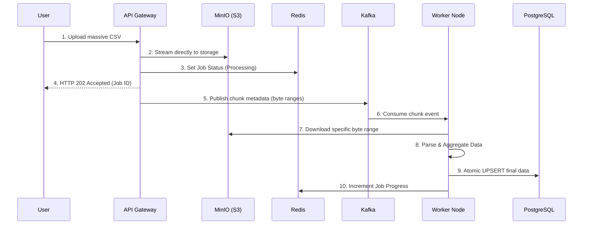

# Distributed File Processing System 🚀


A highly scalable, production-grade distributed backend system designed to ingest and process massive files (e.g., 10GB+ CSVs) asynchronously without causing Out-of-Memory (OOM) errors. 

## 🏗 System Architecture

The system is decoupled into an **API Gateway** and a fleet of **Worker Nodes** communicating asynchronously via **Apache Kafka**.



## ✨ Key Engineering Features

1. **OOM Prevention**: Massive file uploads are not loaded into RAM. They are streamed directly to S3 (MinIO) using chunked byte ranges.
2. **Fault Tolerance**: Worker nodes are stateless. If a worker crashes mid-computation, Kafka's consumer groups ensure the chunk is automatically reassigned and processed by another node.
3. **High Concurrency & Atomicity**: The system uses PostgreSQL `ON CONFLICT DO UPDATE` locks to handle concurrent database writes across multiple distributed workers without race conditions.
4. **Blazing Fast Status Tracking**: Redis is used to track the real-time processing progress of a file, preventing the main SQL database from being hammered with read queries.

---

## 🛠 Tech Stack

*   **Language**: Go (Golang)
*   **Message Broker**: Apache Kafka
*   **Database**: PostgreSQL
*   **Object Storage**: MinIO (AWS S3 Compatible)
*   **Caching & State**: Redis
*   **Infrastructure**: Docker & Docker Compose

---

## 🚀 Setup & Installation

### Prerequisites
*   [Docker](https://www.docker.com/) & Docker Compose
*   [Go 1.21+](https://go.dev/)

### 1. Start the Infrastructure
Spin up MinIO, Kafka, Zookeeper, Redis, and PostgreSQL in the background. This will also automatically create the database tables and MinIO buckets.
```bash
docker-compose up -d
```

### 2. Start the Worker Node
In a new terminal instance, start the consumer worker:
```bash
go run worker/main.go
```
*(You can spin up multiple instances of this to simulate a distributed worker fleet!)*

### 3. Start the API Gateway
In another terminal, start the main HTTP server:
```bash
go run api/main.go
```

---

## 🔌 API Reference

### 1. Upload File
Uploads a large CSV and queues it for distributed processing.
*   **Endpoint**: `POST /upload`
*   **Payload**: `multipart/form-data` (key: `file`)
*   **Response**: `HTTP 202 Accepted`
```json
{
  "message": "File accepted for processing",
  "job_id": "c56a4180-65aa-42ec-a945-5fd21dec0538"
}
```

### 2. Check Job Status
Real-time progress polling (sub-millisecond latency via Redis).
*   **Endpoint**: `GET /status/{job_id}`
*   **Response**: `HTTP 200 OK`
```json
{
  "job_id": "c56a4180-65aa-42ec-a945-5fd21dec0538",
  "status": "processing",
  "progress": 75,
  "total_chunks": 100,
  "completed_chunks": 75
}
```
