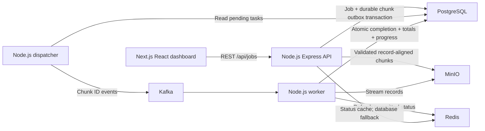

# Flow — Distributed File Processing

A JavaScript application with a **Next.js frontend**, **Node.js/Express REST API**, and **Node.js Kafka workers**. It validates and streams sales CSV uploads into MinIO, processes chunks asynchronously, and displays regional totals. The application has no Go source or Go build dependency. Docker uses a compiler internally to build the third-party MinIO server from its official release source; no local Go installation is needed.

## Start the complete application

Prerequisites: Docker Engine/Desktop with Compose v2. The retained Confluent images target Linux x86-64; Apple Silicon may require Docker's x86 emulation.

```sh
cp .env.example .env
# Replace POSTGRES_PASSWORD and MINIO_PASSWORD with your own strong values.
# Use URL-safe alphanumeric characters for POSTGRES_PASSWORD.
docker compose up -d --build --wait --wait-timeout 240
```

Open **http://localhost:8080**. Download the sample CSV, upload it, and select **View results** after processing finishes. Expected sample totals: North 200.00, South 80.00, West 210.00.

```sh
docker compose logs -f api worker
docker compose up -d --scale worker=3
docker compose down
```

MinIO is built from its official release source with a verified SHA-256 checksum because the previous MinIO registry images are not anonymously pullable. The first Docker build takes longer while compiling storage. A one-shot Node.js service creates the uploads bucket and removes anonymous access policies; it does not require `minio/mc`.

Only the API port is exposed, on loopback by default. Named volumes persist PostgreSQL, MinIO, and Kafka data. Redis is a disposable cache. `docker compose down` preserves data; `down -v` deletes it.

## Architecture



Next.js uses the App Router and React. Its dashboard is statically exported during `npm run build` and served by Express alongside the REST API. This is a real Next.js build without a second frontend server in production. There are no Next.js API routes or server-rendered per-request pages. Uploads go directly to Express, avoiding an extra Next.js upload proxy in production.

The API, dispatcher, and workers are JavaScript ES modules. Kafka distributes work, MinIO stores chunk bodies through its S3-compatible API, PostgreSQL is authoritative for jobs/results, and Redis caches job status for up to 10 seconds. The list endpoint reads PostgreSQL; the individual status endpoint can use Redis.

### Reliability

1. **Streaming:** Busboy reads multipart input; `csv-parse` validates complete records. An approximately 4 MiB chunk is uploaded before reading continues. Backpressure is preserved; there is no entire-file buffer or local upload spool.
2. **Safe boundaries:** chunks contain complete CSV records, including quoted commas/newlines. The header is validated and omitted from stored chunks. Workers revalidate stored records.
3. **Durable acceptance:** the full upload is validated and stored before a transaction creates the job and pending chunk records. HTTP `202` means durable queue creation succeeded, not that aggregation finished.
4. **Outbox:** dispatchers publish pending chunk IDs, recording publication only after Kafka acknowledgment. Unfinished tasks become eligible again after five minutes. Multiple dispatchers can publish duplicates safely.
5. **Idempotent effects:** a worker locks the job row, claims an incomplete chunk, updates regional totals, and increments progress in one PostgreSQL transaction. Duplicate delivery cannot add the same chunk twice. Kafka offsets are committed afterward.
6. **Exact totals:** amounts are parsed into JavaScript `BigInt` cents. PostgreSQL stores BIGINT values; JSON returns cent strings, and React formats them without floating-point loss.
7. **Redis consistency:** workers refresh Redis from committed PostgreSQL state. A Lua compare-and-set prevents delayed updates from reducing completed-chunk counts or replacing a terminal status. Cache entries expire after 10 seconds; reads/writes have a short cancellation deadline, and unavailable Redis falls back to PostgreSQL. Redis is never independently incremented.
8. **Failures:** infrastructure failures retry without advancing the Kafka offset. Invalid stored CSV or numeric overflow marks the job failed. Heartbeats continue during processing, and shutdown cancels active work.

Kafka delivery remains at least once; database effects are idempotent. This is not a distributed exactly-once transaction. Job-row locks serialize commits for the same job, although storage reads and parsing can happen concurrently. Six topic partitions allow at most six active consumers in this consumer group.

## Code map

| File | Responsibility |
| --- | --- |
| `app/page.js` | React upload form, activity polling, results and error states |
| `app/globals.css` | Responsive interface styles |
| `server/index.mjs` | Starts Express and shuts it down gracefully |
| `server/app.mjs` | REST routes and production frontend hosting |
| `server/lib/upload.mjs` | Streaming multipart upload and durable job creation |
| `server/lib/csv.mjs` | CSV validation, chunking, BigInt amounts and aggregation |
| `server/worker.mjs` | Kafka consumer, dispatcher loop, heartbeats and retries |
| `server/lib/process.mjs` | Outbox publishing and transactional processing |
| `server/lib/jobs.mjs` | Redis cache and PostgreSQL status fallback |
| `server/lib/clients.mjs` | PostgreSQL, Redis, Kafka and S3 clients |
| `init.sql` | Database tables and indexes |

## REST API

| Method | Route | Response |
| --- | --- | --- |
| POST | `/api/jobs` | Multipart `file` field; `202` with `job_id` |
| GET | `/api/jobs` | Latest 100 jobs, newest first |
| GET | `/api/jobs/:id` | Job status, rows, chunk counts and progress |
| GET | `/api/jobs/:id/results` | Completed results: `[{"region":"North","total_cents":"20000"}]` |
| GET | `/api/config` | Configured maximum upload size for the UI |
| GET | `/healthz` | Database/storage health and Redis connection state |

Validation errors return `400`; oversized files `413`; unknown jobs `404`; incomplete/failed results `409`; unavailable dependencies `503`. The legacy `/upload`, `/jobs`, `/status/:id`, and `/results/:id` routes remain as compatibility aliases.

`/healthz` does not assert that Kafka or workers are healthy. Monitor worker logs, queue age and consumer lag. Results check authoritative database state, even if cached progress briefly lags.

## CSV contract

```csv
id,region,amount,timestamp
1,North,125.50,2026-01-01T10:00:00Z
2,"South, Coastal",89.25,2026-01-01T11:00:00Z
3,North,-9.25,2026-01-01T12:00:00Z
```

- Four required columns in that order; a UTF-8 BOM is accepted.
- IDs and regions must be nonempty. Regions are case sensitive and limited to 100 UTF-8 bytes.
- Decimal amounts allow at most two fractional digits and negative adjustments. The whole-number magnitude is limited to 1 billion. Exponent notation, NaN, and Infinity are rejected.
- Timestamps must use RFC3339 syntax with a valid date/time (leap seconds are not accepted).
- CRLF/LF/CR record delimiters and quoted multiline fields are supported. Empty/header-only or malformed files are rejected.
- Parser records have an approximately 1 MiB size guard. Chunks target 4 MiB and may exceed it by one complete record. Memory also includes parser/client buffers, metadata, and per-chunk regional aggregates; concurrent uploads increase usage.
- The default file limit is **16 GiB**, configurable through `MAX_UPLOAD_BYTES`. This is a configured limit, **not a verified 16 GiB performance result**.
- Uploading the same file twice creates separate jobs. Row IDs are not used for deduplication; only chunk delivery is deduplicated.

## JavaScript development

Use Node.js 24 LTS (minimum 22.13) and npm. Infrastructure must be reachable through the configured addresses for real data operations.

```sh
npm ci
npm run build
npm start
# Separate terminal:
npm run worker
```

For frontend hot reload, run `npm run dev` on port 3000 alongside the API on port 8080. The development server proxies `/api/*` to Express. Use the production port 8080 for large-file validation/benchmarks; the development proxy is not the large-upload path.

Compose keeps infrastructure private. For local Node processes, supply reachable service endpoints using your own local infrastructure or a local Compose port override. Do not expose infrastructure ports publicly. You can also preview the built dashboard without infrastructure; it will correctly show connection errors rather than fabricated results.

### Environment

| Variable | Purpose |
| --- | --- |
| `POSTGRES_PASSWORD` | Compose database password, embedded in its connection URL |
| `MINIO_USER`, `MINIO_PASSWORD` | MinIO credentials |
| `PORT`, `BIND_ADDRESS` | Compose published port/address; defaults `8080`, `127.0.0.1` |
| `MAX_UPLOAD_BYTES` | File-byte upload limit; default `17179869184` |
| `UPLOAD_TIMEOUT_MS` | Node request timeout; default one hour |
| `DATABASE_URL` | Node PostgreSQL connection URL |
| `REDIS_URL` | Redis connection URL; default `redis://localhost:6379` |
| `MINIO_ENDPOINT`, `MINIO_SECURE`, `MINIO_BUCKET` | S3-compatible host:port, TLS toggle, bucket |
| `S3_REGION` | S3 signing region; default `us-east-1` |
| `KAFKA_BROKERS` | Comma-separated broker addresses |
| `HTTP_HOST` | Express bind host; default `0.0.0.0` inside the container |

## Tests

```sh
npm test                         # Node tests: CSV, HTTP, transactions and cache fallback
npm run build                    # Production Next.js export
npx playwright install chromium
npm run test:browser             # Real frontend, intercepted API responses
npm run test:smoke               # Requires the real Compose stack
# Real PostgreSQL/MinIO/Redis concurrency and cache checks:
docker compose -f docker-compose.yml -f docker-compose.test.yml run --rm integration
```

GitHub Actions is configured to run these checks, build the containers, and execute real-service tests. Local database/storage test doubles do not establish real service interoperability. See `TESTING.md` for what was actually run during migration.

### Preparing a large-file benchmark

The streaming generator produces a CSV and an expected-results manifest, refusing to overwrite existing files:

```sh
mkdir -p benchmarks
npm run generate:csv -- benchmarks/sales-12gib.csv 12884901888
```

This consumes over 12 GiB of disk plus storage for the uploaded chunks. It is intentionally not part of the default test suite. Record exact results, wall time, peak API/worker memory, worker count, machine specs and consumer lag when benchmarking. Test killing a worker during processing and verify that totals remain unchanged after recovery. No 10GB+ benchmark or worker-kill test is claimed by this repository's migration report.

## Upgrade from the earlier implementation

The durable `jobs`, `chunks`, and `job_sales` schema and Kafka `chunk_id` messages are retained. Stop the old API/workers before starting the JavaScript services. Existing records in those tables can be read by the new API; verify the upgrade on a copy of your data first.

For an older PostgreSQL volume that lacks these tables, apply the additive schema:

```sh
docker compose up -d postgres
docker compose exec -T postgres psql -U sde_user -d sales_db < init.sql
```

Use the password already associated with an existing database volume. Changing `.env` does not rotate database credentials. The original global `region_sales` table and pre-outbox job data are not converted into job-specific results. New cache keys use `flow:job:` and do not reuse old Redis status entries.

## Deployment boundaries

This is a single-host Compose deployment for a trusted workspace. It has no built-in users or tenant isolation: anyone who can reach the API can read jobs and upload files. Put an authenticated HTTPS reverse proxy in front before granting remote access; configure its body-size and timeout limits appropriately.

Accepted objects/results have no automatic retention policy. Failed uploads attempt cleanup, but a crash or ambiguous database commit can leave orphaned objects. Add reconciliation, backups, monitoring, supported infrastructure image maintenance, admission control and a retry/dead-letter policy before sustained production use. No live cloud deployment is performed automatically.
